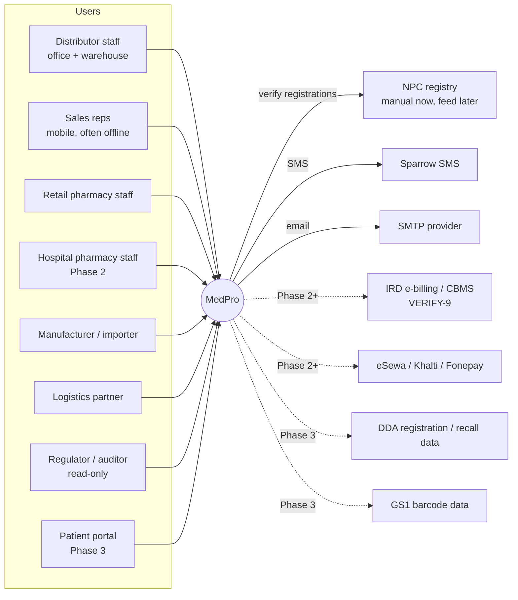
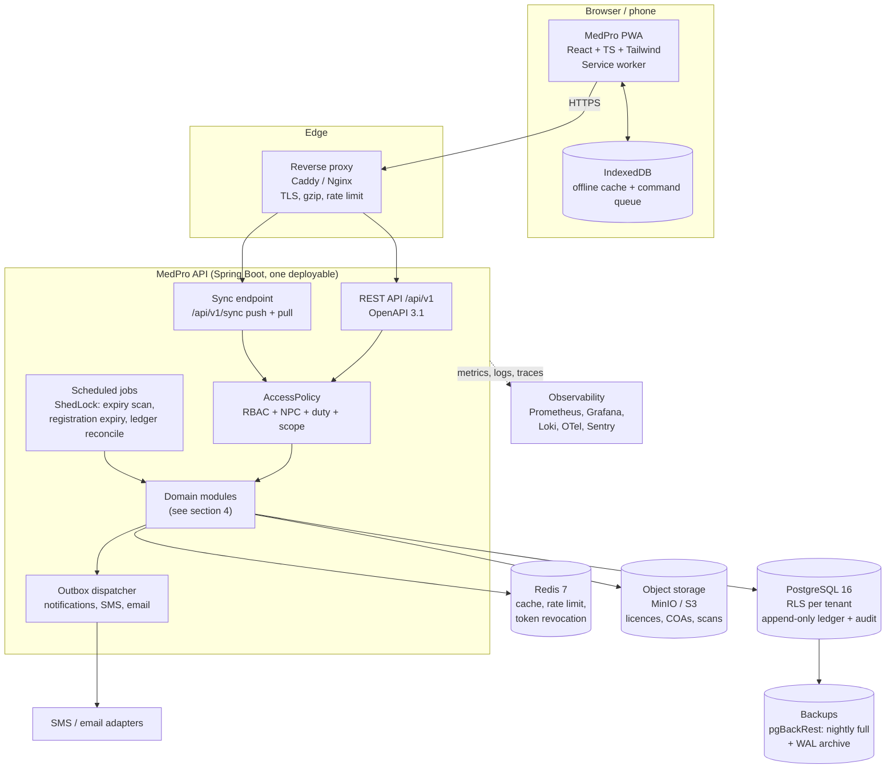
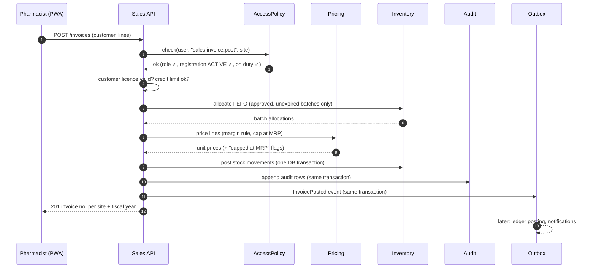
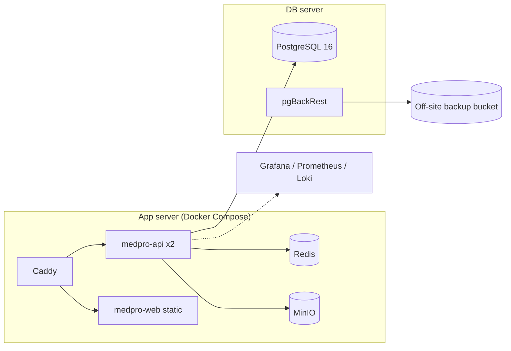

# MedPro: Architecture and Module Breakdown

**Deliverable 2 of 9** · Draft for sign-off · 2026-10-09
Builds on [01-requirements.md](01-requirements.md) (signed off).

---

## 1. Key design decisions

| # | Decision | Why |
|---|---|---|
| D1 | **Modular monolith** in Spring Boot 3 (Java 21), with module boundaries enforced by Spring Modulith. Not microservices. | One team, about 300 pilot users. One deployable is far cheaper to run and debug in Nepal-hosted infrastructure. Module boundaries are checked in tests, so any module can be split out later. |
| D2 | **PostgreSQL 16 as the single source of truth**, shared schema with `tenant_id` + row-level security. | Stock correctness needs real transactions. RLS gives a second line of defence if application code forgets a tenant filter. |
| D3 | **Stock = append-only movement ledger**. Balances are a projection, rebuilt and reconciled nightly. | Your rule: never edit stock silently. It also makes offline sync safe, because sync replays commands, not balances. |
| D4 | **Commands, not state, for offline sync.** The PWA queues intents ("sell 10 of batch X") with client-generated UUIDv7 ids. The server validates each against current rules and the ledger. | Rules such as registration status, MRP cap and FEFO are always enforced on the server, even for work done offline. Idempotency keys make retries safe. |
| D5 | **Transactional outbox** (Spring Modulith event publication registry) for notifications, SMS, email and integrations. No message broker at pilot. | Events are written in the same transaction as the business change, so nothing is lost if SMS fails. A broker (RabbitMQ or Kafka) can be added behind the same interface later. |
| D6 | **Authentication in-app** with Spring Security: password + optional TOTP, RS256 JWT access tokens (15 min) and rotating refresh tokens. OIDC-compatible so Keycloak or a national ID provider can replace it later. | Fewer moving parts for the pilot. Authorisation (roles + NPC registration + site scope) is MedPro-specific and lives in-app either way. |
| D7 | **Authorisation as a policy check on every command**: `role permission` ∧ `active professional registration of required category` ∧ `site scope` ∧ `pharmacist on duty` (where required). One `AccessPolicy` service, called from every write endpoint. | Keeps the legal rules in one tested place, driven by config tables. |
| D8 | **Rule values in a versioned config store** (`rule_setting` table with effective-from dates), not in code or YAML. | Every legal value can change without a deploy, and past transactions can show which rule version applied. |
| D9 | **Adapters (ports) for the outside world**: NPC registry, SMS, email, payments, IRD e-billing, GS1 lookup, DDA feeds. | Your brief asks for a pluggable NPC feed; the same pattern covers every external dependency. |
| D10 | **Object storage (S3-compatible, MinIO on-prem)** for licences, COAs, certificate scans. | Keeps large files out of PostgreSQL; files encrypted at rest and served through short-lived signed URLs. |
| D11 | **Redis** for caching reference data, rate limiting, token revocation list and short-lived locks. Not used as a source of truth. | Redis can be flushed with no data loss. |
| D12 | **Frontend: React + TypeScript + Tailwind PWA**, Vite build, TanStack Query, IndexedDB (Dexie) for the offline store and queue, i18next for Nepali/English, a BS date library wrapped in our own `dates` package. | Matches your suggested stack. Wrapping BS conversion lets us swap the calendar table without touching screens. |

---

## 2. System context

---

## 3. Container view

---

## 4. Module breakdown

Each module is a top-level Java package under `np.medpro`. Modules talk to each other only through their public API package or through domain events. Spring Modulith's `ApplicationModules.verify()` runs in CI and fails the build on any illegal dependency.

| Module | Owns (main tables) | Key responsibilities | Depends on | Phase |
|---|---|---|---|---|
| **platform** | `tenant`, `organization`, `site`, `location`, `rule_setting` | Tenancy, sites and locations, versioned rule config, BS/AD calendar service, money and numbering (per site per fiscal year) | none | 1 |
| **identity** | `app_user`, `role`, `permission`, `user_role`, `session`, `refresh_token` | Login, TOTP, JWT, roles and permissions, session revocation | platform | 1 |
| **registry** | `professional`, `registration`, `registration_event`, `duty_roster` | NPC registers, status lifecycle, expiry alerts, auto-lapse, duty roster, `NpcRegistryPort` adapters | platform, identity | 1 (feed in 3) |
| **access** | `action_requirement` | `AccessPolicy`: combines role, registration category, site scope and pharmacist-on-duty. Co-sign flow. | identity, registry | 1 |
| **audit** | `audit_log` (hash-chained) | Append-only audit writer, chain verification job, audit viewer queries | platform | 1 |
| **catalog** | `product`, `generic`, `manufacturer`, `product_unit`, `batch`, `document` | Product and batch master, substitutes, batch status, DDA registration fields (placeholder rules), documents (COA, licences) | platform | 1 |
| **inventory** | `stock_movement` (append-only), `stock_balance` (projection), `stock_count`, `reorder_policy` | Ledger posting, FEFO allocation, quarantine, transfers, adjustments with approval, cycle counts, expiry and reorder alerts, nightly reconcile | catalog, access | 1 |
| **partners** | `party`, `party_licence`, `credit_terms` | Suppliers and customers (retailers, hospitals), licences with expiry, credit limits | platform, catalog | 1 |
| **procurement** | `purchase_request`, `purchase_order`, `goods_receipt`, `supplier_invoice`, `purchase_return` | PR → PO → GRN → invoice, three-way match, returns and debit notes. PPA 2063 workflow added in Phase 2. | partners, inventory, pricing | 1 |
| **pricing** | `price_rule`, `scheme` | Margin rules per tier/category/product, MRP cap, manufacturer schemes and bonus | catalog, platform | 1 |
| **sales** | `sales_order`, `invoice`, `invoice_line`, `delivery_challan`, `sales_return`, `credit_note` | Distributor order-to-invoice, credit and licence checks, retail counter billing, returns | inventory, pricing, partners, access | 1 |
| **dispensing** | `patient` (minimal, encrypted), `prescription`, `dispense`, `counselling_note` | Prescription capture, dispense against prescription, counselling notes, controlled-drug register hook | sales, access | 1 |
| **finance** | `ledger_account`, `journal_entry`, `receipt`, `payment` | Auto-posting from invoices, GRNs and payments; receivables and payables ageing. Hospital pharmacy ledger rules in Phase 2. | sales, procurement | 1 (basic) / 2 |
| **notification** | `notification`, `notification_pref`, outbox | In-app inbox, email, SMS via adapters, templates in Nepali and English | platform | 1 |
| **reporting** | read models, materialised views | Dashboards, CSV/PDF export, Ministry reports (Phase 2) | read-only access to all | 1 (basic) |
| **sync** | `sync_command`, `sync_cursor` | Offline command intake with idempotency, pull of changed reference data per site | all write modules via their APIs | 1 (counting, receiving, OTC sales) / 2 (full) |
| **compliance** | `compliance_checklist`, `controlled_register`, `recall` | Placeholder modules from requirements 3.10: drug registration, import, narcotics, Drug Sale and Distribution Code checklist, recall | catalog, inventory, partners | placeholders 1, full 3 |
| **formulary** | `formulary_item`, `committee`, `meeting`, `decision`, `adr_report` | Formulary, P&T and Pharmacy Operation Committees, ADR, antimicrobial use | catalog | 2 |
| **freecare** | `stock_pool`, `free_care_eligibility`, `free_care_record` | Free, donated and bonus stock pools; eligibility; 10% quota; public availability list | inventory, dispensing | 2 |
| **logistics** | `shipment`, `shipment_leg`, `temperature_log`, `storage_profile` | Shipments, proof of delivery, cold-chain logging and alerts | inventory, partners | 2 |
| **traceability** | `trace_event`, GS1 identifiers | Batch track and trace, GS1 scanning, recall execution | inventory, sales, compliance | 3 |
| **forecasting** | `demand_history`, `forecast` | Demand forecast and suggested reorder quantities | inventory, sales | 3 |
| **staffing** | `staffing_rule`, `staffing_gap` | Bed-count staffing checker and workload additions | registry, platform | 3 (hospital rules, your table as config) |
| **portal** | none (views) | Patient portal | dispensing, freecare | 3 |

---

## 5. How a sale flows (distributor invoice)

Everything in steps 2 to 10 happens in one database transaction. If any check fails, nothing is written except a "rejected" audit row.

---

## 6. Offline sync

1. The PWA caches reference data for its site (products, batches, prices, its own stock balances, users on the roster) and refreshes with `GET /sync/pull?since=<cursor>`.
2. Offline actions are stored as **commands** in IndexedDB, each with a UUIDv7 `command_id`, the user, device, local timestamp (AD and BS) and payload.
3. On reconnect, `POST /sync/push` sends commands in order. The server runs each through the normal module API (so `AccessPolicy`, MRP cap, FEFO and licence checks all apply) and records the `command_id` so a retry never double-posts.
4. Results come back per command: `APPLIED`, `APPLIED_WITH_ADJUSTMENT` (for example a different batch was allocated) or `REJECTED` with a reason. Rejected sales go to a review queue for the pharmacist rather than disappearing.
5. Allowed offline (Phase 1): stock counts, goods receiving (draft), sales-rep order booking, OTC counter sales. Not allowed offline: prescription-only and controlled items (Q-5 default), approvals, price changes.

---

## 7. Security architecture

- **Transport:** TLS 1.2+ at the proxy; HSTS; internal traffic on a private network.
- **At rest:** encrypted disks for PostgreSQL and object storage; patient name, phone and ID number encrypted at column level with a key held outside the database (envelope encryption, key in a KMS or Vault; file-based key for single-server pilot, marked as a pilot compromise).
- **Tenancy:** every request sets `app.tenant_id` on the DB connection; RLS policies filter every tenant table.
- **Ledger and audit immutability:** the application DB role has `INSERT, SELECT` only on `stock_movement` and `audit_log`; a trigger also rejects `UPDATE`/`DELETE`. Audit rows are hash-chained per tenant.
- **Accounts:** one person, one account; TOTP mandatory for Admin, Org Admin and Pharmacist roles (configurable); lockout and rate limits on login.
- **Secrets:** environment variables or Docker secrets, never in the repo; dependency and container scanning in CI.

---

## 8. Deployment topology (pilot)

- Two VMs for the pilot, scaling to Kubernetes later without code changes (stateless API, all state in PostgreSQL / MinIO).
- Hosting location: **[VERIFY-20]** whether medicine, financial or patient data must be hosted inside Nepal. My default is a Nepal data centre for the primary and an off-site encrypted backup.
- CI/CD with GitHub Actions: build, unit and integration tests (Testcontainers PostgreSQL), Modulith boundary check, OpenAPI diff, frontend tests and Playwright end-to-end tests, container image build, deploy to staging on merge to `main`, production on tagged release.

---

## 9. Observability

- Structured JSON logs with `tenant_id`, `site_id`, `user_id`, `request_id` (no patient data in logs).
- Micrometer metrics to Prometheus: request latency, sync queue depth, rejected commands, outbox lag, SMS failures, ledger reconcile drift (should always be 0).
- OpenTelemetry traces; Sentry-compatible error tracking for API and PWA.
- Alerts: ledger drift ≠ 0, audit chain break, outbox lag > 10 min, backup job failure.

---

## 10. New assumption

| ID | Assumption |
|---|---|
| VERIFY-20 | Data residency: whether MedPro data must be hosted in Nepal. |

## 11. Next deliverable

After your sign-off: **Deliverable 3, ERD and PostgreSQL schema** (Flyway migration SQL for all Phase 1 tables, plus outline tables for Phase 2 and 3).
